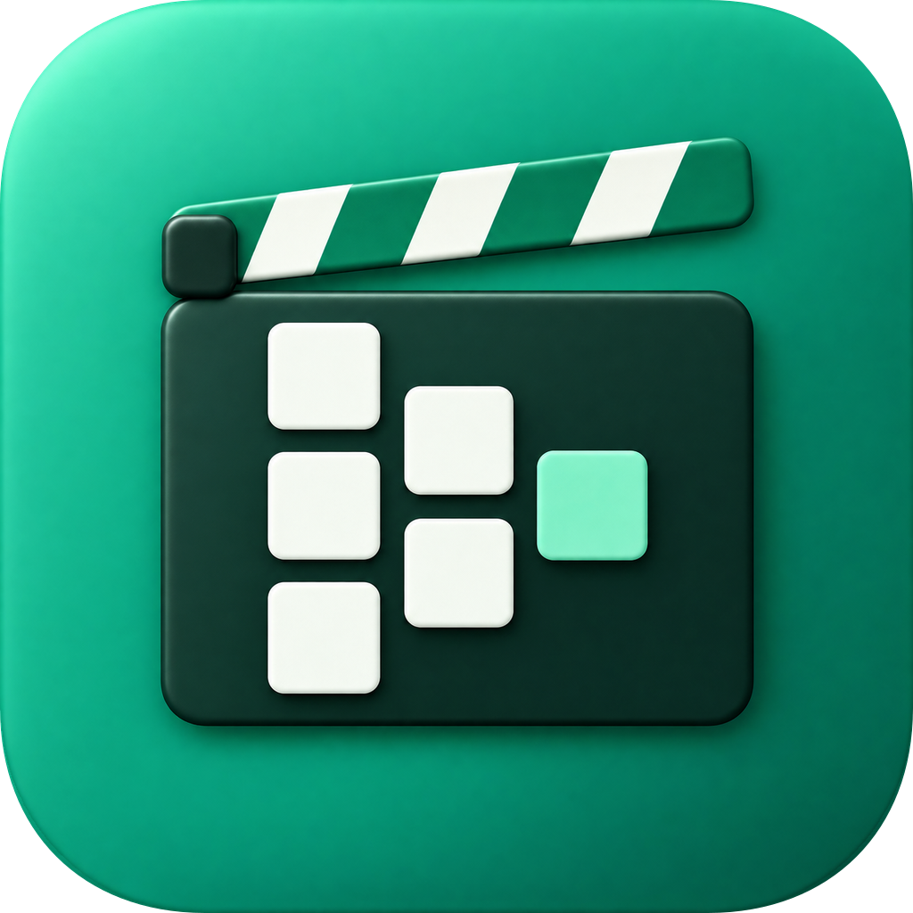

<p align="center">
  
</p>

<h1 align="center">VideoCRM</h1>

<p align="center">A desktop production home for YouTube creators: plan videos, write scripts, edit with AI and upload.</p>

<p align="center">
  <a href="docs/youtube.md#connecting-a-real-youtube-account">Connect YouTube</a>
  ·
  <a href="docs/pipeline.md#requirements">Set up AI editing</a>
  ·
  <a href="docs/ARCHITECTURE.md">Architecture</a>
</p>

- **Plan** every video in a Notion-style database, as a table or a board.
- **Write** scripts in rich documents with B-roll and on-screen cues, word count and runtime.
- **Edit with AI**: hand your raw takes and script to [video-use](https://github.com/browser-use/video-use), approve its plan, get a cut.
- **Upload** to your YouTube channels from the video's page, with resumable uploads. Connect
  several accounts and pick, per video, the channel it goes to.

Everything stays on your computer: one local database and a folder per video.

## Download

Get the latest build from the repository's Releases page:

- **macOS** (Apple silicon and Intel): open `VideoCRM-….dmg` and drag VideoCRM to
  Applications. The app isn't notarized yet, so the first time, right-click it, choose
  **Open**, and confirm.
- **Linux** (x86_64): make `VideoCRM-….AppImage` executable and run it. Or unpack
  `videocrm-…-linux-x86_64.tar.gz` into `~/.local` to get VideoCRM in your app menu:
  `tar -xzf videocrm-…-linux-x86_64.tar.gz -C ~/.local --strip-components=1`.

VideoCRM keeps itself up to date: new versions download in the background and start the
next time you open it, or right away with **Restart to update**.

AI editing also needs [Claude Code](https://claude.com/claude-code), ffmpeg and the
video-use skill; the app checks for them and says what's missing.

## Build from source

Install Rust. On Linux, also install a C/C++ toolchain, CMake, `pkg-config`, and the
development libraries for Fontconfig, FreeType, X11, Wayland and xkbcommon.

```sh
cargo run --release
```
